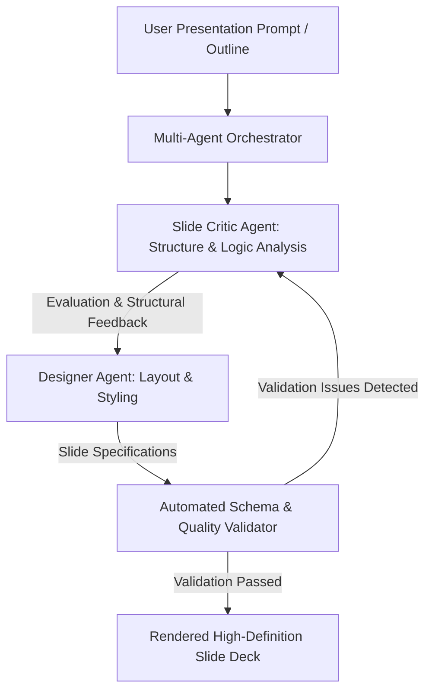

<div align="center">

<h1>SlideWright: Multi-Agent Presentation Studio</h1>


<p><strong>Multi-Agent Artificial Intelligence Architecture for Autonomous Presentation Design</strong></p>

<p>
  <a href="https://skillicons.dev"></a>
</p>

<p>
  <a href="#overview">Overview</a> &bull;
  <a href="#system-architecture">Architecture</a> &bull;
  <a href="#visual-showcase-gallery">Visual Gallery</a> &bull;
  <a href="#core-capabilities">Capabilities</a> &bull;
  <a href="#installation--setup">Installation</a> &bull;
  <a href="#author--contact-information">Author</a>
</p>

</div>

---
## Overview

SlideWright is a multi-agent framework designed for autonomous slide presentation generation. Operating through a decoupled multi-agent loop, a specialized Slide Critic Agent inspects and refines narrative outlines, while an independent Designer Agent synthesizes presentation slides. Automated validation schemas enforce visual clarity, preventing layout regressions.

---

## Visual Showcase Gallery

<table width="100%" align="center">
  <tr>
    <td width="50%" align="center"><b>SlideWright AI Presentation Studio</b><br><sub>Main dashboard for topic prompts and presentation settings.</sub></td>
    <td width="50%" align="center"><b>Critic Agent Structural Review</b><br><sub>Narrative density evaluation and pacing optimization.</sub></td>
  </tr>
  <tr>
    <td align="center"></td>
    <td align="center"></td>
  </tr>
  <tr>
    <td width="50%" align="center"><b>Designer Agent Layout Synthesis</b><br><sub>Component placement, color hierarchy, and visual balance.</sub></td>
    <td width="50%" align="center"><b>Complete Presentation Deck Output</b><br><sub>Rendered presentation slides with export capabilities.</sub></td>
  </tr>
  <tr>
    <td align="center"></td>
    <td align="center"></td>
  </tr>
  <tr>
    <td width="50%" align="center"><b>Topic Taxonomy & Keyword Map</b><br><sub>Subject outline decomposition and conceptual clustering.</sub></td>
    <td width="50%" align="center"><b>Slide Typography & Styling Engine</b><br><sub>Font pairing, heading hierarchy, and contrast validation.</sub></td>
  </tr>
  <tr>
    <td align="center"></td>
    <td align="center"></td>
  </tr>
  <tr>
    <td width="50%" align="center"><b>Multi-Agent Message Inspection Log</b><br><sub>Real-time communication log between Critic and Designer agents.</sub></td>
    <td width="50%" align="center"><b>Export & Slide Deck Delivery Hub</b><br><sub>PDF, HTML, and Markdown presentation bundle exports.</sub></td>
  </tr>
  <tr>
    <td align="center"></td>
    <td align="center"></td>
  </tr>
  <tr>
    <td colspan="2" align="center"><b>SlideWright System Architecture Mockup</b><br><sub>High-level visual mock showing multi-agent interaction flow.</sub></td>
  </tr>
  <tr>
    <td colspan="2" align="center"></td>
  </tr>
</table>

---

## System Architecture



---

## Technology Stack

| Domain | Technologies |
| :--- | :--- |
| Frontend Interface | React, TypeScript, Tailwind CSS |
| Agent Orchestration | TypeScript Multi-Agent Architecture |
| Validation | Zod Schemas |
| Build Tooling | Vite, Node.js |

---

## Installation & Setup

```bash
# Clone the repository
git clone https://github.com/sohailahmed-bsrh/slidewright.git
cd slidewright

# Install dependencies and start
npm install
npm run dev
```
---

## Author & Contact Information

<table width="100%" align="center">
  <tr>
    <td align="center" style="padding: 20px;">
      <h3>Sohail Ahmed</h3>
      <p><strong>Full-Stack Artificial Intelligence & Computer Vision Engineer</strong></p>
      <p>
        <a href="https://sohail.devsil.com"></a>
        <a href="https://github.com/sohailahmed-bsrh"></a>
        <a href="https://linkedin.com/in/sohail-ahmed-dev"></a>
        <a href="mailto:sohail.bsrh@gmail.com"></a>
      </p>
      <p><em>Available for technical roles in Artificial Intelligence, Computer Vision, and Full-Stack Engineering.</em></p>
      <hr style="border: 0; height: 1px; background: #30363d; margin: 15px 0;">
      <small>Repository: <code>sohailahmed-bsrh/slidewright</code> &bull; Distributed under the MIT License.</small>
    </td>
  </tr>
</table>
