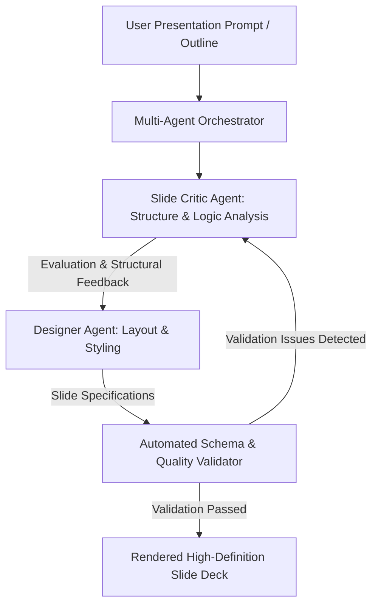

<div align="center">

<h1>SlideWright: Multi-Agent Presentation Studio</h1>


<p><strong>Multi-Agent Artificial Intelligence Architecture for Autonomous Presentation Design</strong></p>

<p>
  <a href="https://skillicons.dev"></a>
</p>

</div>

---

## Executive Summary

SlideWright is a multi-agent framework designed for autonomous slide presentation generation. Operating through a decoupled multi-agent loop, a specialized Slide Critic Agent inspects and refines narrative outlines, while an independent Designer Agent synthesizes presentation slides. Automated validation schemas enforce visual clarity, preventing layout regressions.

---

## Application Interface & Presentation Deck Gallery

<table align="center">
  <tr>
    <td align="center"><b>SlideWright AI Presentation Studio</b><br><sub>Main dashboard for topic prompts and presentation settings.</sub></td>
    <td align="center"><b>Critic Agent Structural Review</b><br><sub>Narrative density evaluation and pacing optimization.</sub></td>
  </tr>
  <tr>
    <td align="center"></td>
    <td align="center"></td>
  </tr>
  <tr>
    <td align="center"><b>Designer Agent Layout Synthesis</b><br><sub>Component placement, color hierarchy, and visual balance.</sub></td>
    <td align="center"><b>Complete Presentation Deck Output</b><br><sub>Rendered presentation slides with export capabilities.</sub></td>
  </tr>
  <tr>
    <td align="center"></td>
    <td align="center"></td>
  </tr>
</table>

---

## System Architecture



---

## Technology Stack

| Domain | Technologies |
| :--- | :--- |
| Frontend Interface | React, TypeScript, Tailwind CSS |
| Agent Orchestration | TypeScript Multi-Agent Architecture |
| Validation | Zod Schemas |
| Build Tooling | Vite, Node.js |

---

## Installation & Setup

```bash
# Clone the repository
git clone https://github.com/sohailahmed-bsrh/slidewright.git
cd slidewright

# Install dependencies and start
npm install
npm run dev
```

---

## Author & License

- **Author**: Sohail Ahmed ([Portfolio](https://sohail.devsil.com) | [GitHub](https://github.com/sohailahmed-bsrh))
- **License**: Distributed under the MIT License.
