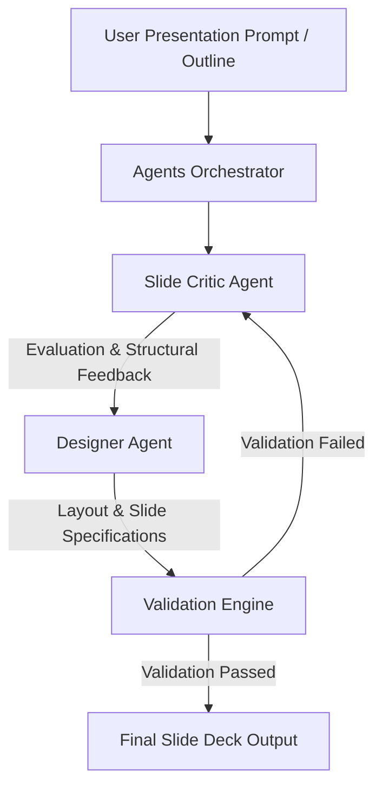

# SlideWright

## Overview
SlideWright is a multi-agent artificial intelligence framework engineered for autonomous presentation generation, slide critique, and visual design synthesis. Employing a decoupled multi-agent architecture, the system translates structured concepts into polished presentation deliverables.

## System Architecture



## Core Features
- **Decoupled Agent Architecture**: Independent critic and designer agents operating with specialized prompts and validation schemas.
- **Automated Structural Critique**: Multi-point inspection verifying slide readability, information density, and audience alignment.
- **Design Layout Synthesis**: Automated translation of narrative outlines into structured presentation slides.
- **Validation Pipeline**: Automated schema and formatting verification preventing layout regressions.

## Repository Structure
```
slidewright/
|-- agents/
|   |-- config/
|   |   |-- agents.config.ts
|   |   +-- models.config.ts
|   |-- critic/
|   |   |-- index.ts
|   |   |-- prompt.ts
|   |   |-- run.ts
|   |   +-- validate.ts
|   |-- designer/
|   |   |-- index.ts
|   |   |-- prompt.ts
|   |   |-- run.ts
|   |   +-- validate.ts
|   +-- index.ts
|-- PROJECT_RULES.md
+-- README.md
```

## Technology Stack
| System Component | Technology |
| :--- | :--- |
| Runtime | Node.js / TypeScript |
| Agent Orchestration | Custom Multi-Agent Runtime |
| Model Integrations | LLM API Clients |
| Schema Validation | Zod |

## Installation & Setup
```bash
# Clone the repository
git clone https://github.com/sohailahmed-bsrh/slidewright.git
cd slidewright

# Configure environment variables
cp .env.example .env

# Run agents pipeline
npm install
npm run build
npm start
```

## License
Distributed under the MIT License.
